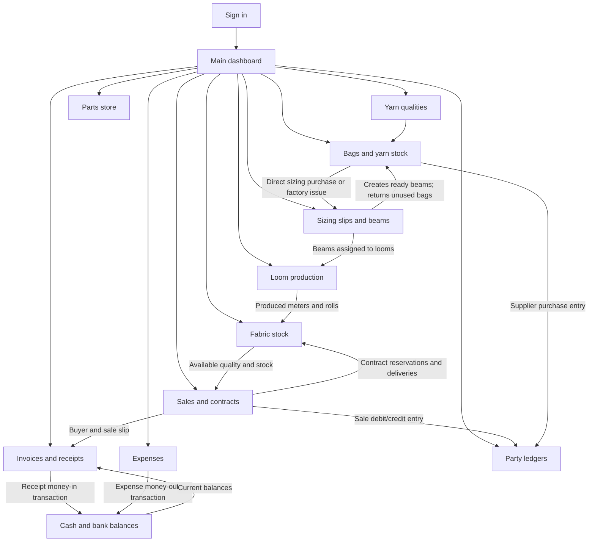

# LoomFlow Textile Operations Roadmap

## What this roadmap covers

This is a guide to how the application works today: what each module is for, what records it creates or changes, and how information moves between modules. It is an operations and data-flow map, not a promise that every step is automatic.

LoomFlow is a Laravel application. Users sign in, open the main hub, and enter records through authenticated module screens. The modules share database records for yarn qualities, bag movements, sizing slips and beams, fabric qualities, contracts and sales, customers, invoices, financial accounts, expenses, and party ledger entries.

## Start here: clickable module guides

| Module | What it is for | Detailed guide |
|---|---|---|
| Authentication | Sign in, demo sign-in, and session sign-out | [Authentication guide](./AUTH_MODULE_README.md) |
| Main dashboard | Operations overview and navigation hub | [Dashboard guide](./DASHBOARD_MODULE_README.md) |
| Yarn qualities | Shared yarn quality/count reference list | [Yarn qualities guide](./YARN_QUALITIES_MODULE_README.md) |
| Bags | Yarn purchases, factory stock, sizing issues, and returns | [Bags guide](./BAGS_MODULE_README.md) |
| Sizing | Bag reconciliation, sizing slips, finished beams, and loom assignment | [Sizing guide](./SIZING_MODULE_README.md) |
| Parts | Loom spare-parts inventory and issuance | [Parts guide](./PARTS_MODULE_README.md) |
| Production | Loom shifts, beam consumption, roll entry, and production reports | [Production guide](./PRODUCTION_MODULE_README.md) |
| Fabric Stock | Finished-fabric qualities, meter balances, rolls, and stock movement | [Fabric Stock guide](./FABRIC_STOCK_MODULE_README.md) |
| Sales | Open-market dispatches, contract deliveries, and buyer contracts | [Sales guide](./SALES_MODULE_README.md) |
| Invoices | Customer records, invoices, receipts, and cash/bank accounts | [Invoices guide](./INVOICES_MODULE_README.md) |
| Expenses | Fixed expense schedules and variable/fixed payment records | Expense workflow below; see [expense implementation](./app/Http/Controllers/ExpenseController.php) |
| Ledgers | Filterable party debit/credit history | [Ledgers guide](./LEDGERS_MODULE_README.md) |

## Big picture: how modules connect

The diagram shows the main operational handoffs. Some modules share a record or balance directly; others only display information from another module. Details and important exceptions are described below.

## Recommended operating sequence

### 1. Sign in and open the hub

Open `/login`, sign in, and use `/` or `/dashboard` as the entry point. The hub summarizes current operation figures and links to the module screens. It is a read-only overview; create or correct source records in their owning modules.

**Prerequisite:** the user must have a valid account. The login page also exposes demo quick-login buttons for existing demo accounts.

### 2. Set up reference data and opening records

Before entering transactions, create the reference records that the forms depend on:

- Add yarn count/quality labels from Bags or Sizing using the shared Yarn Qualities list.
- Define fabric qualities in Fabric Stock. A newly created fabric quality starts at zero meters.
- Create part records in Parts with opening quantities, units, and alert thresholds.
- Add customers and active cash/bank accounts in Invoices when they are needed for billing and receipts.
- Create fixed-expense setups in Expenses for repeat costs that staff want to track by billing period.

Reference lists are not interchangeable: **yarn qualities** describe yarn used by Bags and Sizing; **fabric qualities** describe finished goods used by Production, Fabric Stock, Sales, and Invoices.

### 3. Purchase yarn and route the bags

Create a purchase in Bags and split the total bag quantity exactly between:

- **To Factory Godown:** received into factory stock and eligible for a later issue to sizing.
- **Direct to Sizing:** delivered straight to a sizing party and immediately available as a pending sizing receipt.

The selected yarn quality must already exist. A direct-to-sizing quantity also needs its sizing destination. Saving creates a purchase, stock movement records for each non-zero split, and a supplier party-ledger entry.

**Next step:** direct sizing receipts can be selected in Sizing; factory stock must first be issued to sizing.

### 4. Issue factory stock and record sizing

In Bags, issue a quantity from factory stock to a sizing mill/person. The controller checks available factory stock for the selected yarn quality before saving. A successful issue creates another pending sizing receipt.

In Sizing, select a pending direct purchase or factory issue and create one sizing slip for that receipt. The source receipt supplies its quantity, quality, and party; a receipt can be linked to one sizing slip only. Record used, returned, and held bags and the sizing set details. When returned-to-factory bags are entered on the slip, the system creates a return movement back to the factory store.

Saving the sizing slip also creates the finished beam records. Select **Raw Perch** for gate-pass and beam information, or **Final Perch** when recording the sizing invoice and returned-material deductions.

**Important distinction:** the Bags **Receive Return** form records a separate received return. Do not record the same physical return a second time if it was already entered as returned bags on the sizing slip.

### 5. Mount beams and record weaving

In Sizing, mount a ready beam onto its loom. Then, in Production, record the loom shift with its starting/ending meter readings, beam consumption, shift, operator, loom speed, and picks per inch.

The shift action checks that the selected beam is mounted on the selected loom and that consumption does not exceed its remaining length. It records net fabric meters and calculated production measures, reduces the beam remainder, and increases the selected fabric quality's stock.

For production entered only as daily loom rolls and meters, use the Production **Daily Loom Roll Register** instead. This records roll rows and adds the combined meters and roll count to fabric stock without consuming a sizing beam.

### 6. Maintain finished fabric and fulfill orders

Fabric Stock maintains quality-level current meters and rolls. The stock-entry form records daily receipts, adjustments, dispatches, and rolls for a quality; the closing meter balance is previous stock + receipts + adjustments − dispatches. Fabric Stock rejects a negative closing balance.

In Sales:

- Use an **open-market sale** to dispatch from the quality's open/available meters.
- Create a **buyer contract** to reserve meters against an existing fabric quality.
- Use a **contract sale** to deliver part or all of an active contract.

Sales validates stock availability. Contract deliveries must match the contract's fabric quality and remaining quantity. A successful sale deducts fabric meters and rolls, updates contract delivery progress when applicable, synchronizes the buyer to Customers, and creates a buyer party-ledger entry.

### 7. Invoice deliveries and receive money

Use Invoices to bill customers:

- Create an invoice from an unbilled sales slip to copy its buyer and sale amounts, or enter manual invoice lines.
- Optionally link a contract. Meter quantities billed against a contract cannot exceed delivered meters that remain unbilled.
- Record a customer receipt against an active cash/bank account.
- Apply the receipt to the oldest open invoices, selected invoice, manual invoice allocations, or leave it as customer credit.

Every receipt adds a money-in transaction to the receiving account. Invoice/payment allocation and party-ledger debit/credit records are separate financial views; a receipt should not be assumed to rewrite an existing party-ledger entry.

### 8. Record operating expenses

In Expenses, define recurring fixed expense setups or record one-off variable expenses. A fixed setup is a schedule/reference; it does **not** automatically pay or post an expense. When payment occurs, staff records it explicitly and selects the account it was paid from.

Each saved fixed or variable expense and its account money-out transaction are written together. The account balance therefore reflects both customer receipts and recorded expenses, as well as manual account deposits/withdrawals.

### 9. Review stock, activity, and financial records

- Use module dashboards for current operational summaries.
- Use the dedicated module history/register pages for the source records.
- Use Bags and Sizing to reconcile yarn bags and beams.
- Use Production and Fabric Stock to review woven output and finished-goods availability.
- Use Sales and Invoices for dispatch, billing, and customer receipts.
- Use the Invoices account page for cash/bank balances and transactions.
- Use Ledgers for party debit/credit entries created by ledger-posting workflows.
- Use Expenses filters to review expense date ranges and fixed/variable totals.

## What each module sends to the next

| From | Record or value produced | Used by | What changes |
|---|---|---|---|
| Yarn Qualities | Unique yarn quality name | Bags, Sizing | Quality dropdown options and validation. |
| Bags purchase | Bag purchase, split movements, supplier ledger entry | Bags dashboard/ledger, Sizing, Ledgers | Factory balance increases for factory portion; direct sizing portion becomes a pending Sizing receipt. |
| Bags issue | `issue_to_sizing` movement | Bags, Sizing | Factory balance falls; movement becomes a pending Sizing receipt. |
| Sizing slip | Linked slip, beam records, optional return movement | Sizing, Production, Bags | Source receipt is consumed once; beams enter ready-in-store; entered returned bags go back to factory stock. |
| Beam assignment | Loom, mounted date, mounted status | Sizing, Production | Beam becomes eligible for shift production on the assigned loom. |
| Production shift | Production record, beam consumption, produced fabric meters | Production, Fabric Stock, dashboard | Beam remaining length falls; finished fabric meters and estimated roll count increase. |
| Production roll register | Production rows per roll and daily stock movement | Production, Fabric Stock | Fabric stock and roll count increase without beam consumption. |
| Fabric Stock | Fabric quality and open/committed/current meters | Production, Sales, Contracts | Acts as finished-goods balance and availability source. |
| Sales contract | Active contract, calculated rate, reserved meters, synchronized customer | Sales, Fabric Stock, Invoices | Fabric availability is divided into open and committed meters. |
| Sales slip | Sale record, stock deduction, customer sync, party ledger entry | Sales, Fabric Stock, Invoices, Ledgers | Meters/rolls are dispatched; contract balances update for contract sales. |
| Invoice | Issued invoice and line items | Invoices, customer billing | Creates a bill; it does not dispatch fabric. |
| Payment receipt | Receipt, invoice allocations, account money-in transaction | Invoices, Accounts | Account money-in increases; invoice due decreases for allocated amounts; excess remains as credit. |
| Expense | Expense record and account money-out transaction | Expenses, Accounts | Account money-out increases; expense history and period totals update. |
| Part issuance | Issuance record and stock decrement | Parts | Part stock decreases; no cash/bank transaction is created by the issue. |
| Ledger entry | Party debit/credit row | Ledgers | Appears in the filterable party statement. |

## Balance ownership: which screen is authoritative?

| Quantity or balance | Owning records/screen | Do not confuse it with |
|---|---|---|
| Factory yarn bags | Bag purchases and bag transactions, summarized in Bags | Total bags ever purchased. |
| Bags at sizing / used / held | Bag movements and sizing-slip reconciliation | A specific party's complete statement. |
| Beam length and status | Sizing beam records | Fabric meters currently in stock. |
| Fabric current meters and rolls | Fabric Stock, updated by stock entries and related workflows | Sales contract agreed meters. |
| Open fabric meters | Current fabric meters less committed contract meters | All physical fabric in the store. |
| Contract remaining meters | Sales contract delivery progress | Invoiceable meters; invoices only bill delivered, unbilled quantities. |
| Invoice balance | Issued invoice total less payment allocations | Cash/bank account balance. |
| Cash/bank balance | Opening account balance + account money-in − money-out | Party-ledger net receivable/payable. |
| Party-ledger balance | Stored debit/credit ledger entries and their recorded balances | Invoice allocation or bank reconciliation. |
| Part stock | Part stock quantity minus saved issuances | Yarn-bag or fabric inventory. |

## Important workflow checks and handoff rules

1. **Quality must match the workflow.** Yarn quality is used for yarn bags and sizing; registered fabric quality is used for beams' output, fabric stock, sales, and production.
2. **Sizing requires a pending bag movement.** If the Sizing form has no eligible receipt, first record a direct-to-sizing purchase or issue factory bags to sizing.
3. **One bag receipt, one sizing slip.** A linked receipt is no longer pending for another sizing slip.
4. **Production requires a mounted beam.** A ready beam must be assigned in Sizing first, and the production loom must match its assigned loom.
5. **Contracts reserve meters; they do not create meters.** Production/stock entry supplies fabric. A sale consumes it.
6. **Billing is not dispatch.** Creating an invoice bills a sale, contract delivery, or manual items; it does not itself deduct fabric stock.
7. **Payment and party ledgers are different ledgers.** Receipts/expenses affect cash/bank account transactions. Only workflows that create a `Ledger` record appear in Party Ledgers.
8. **Fixed expenses are not auto-paid.** Record each payment when it is made; activating a schedule does not create an account transaction.
9. **Part issuance is a stock operation.** It decrements part quantity but does not automatically post a cash/bank expense or party ledger item.
10. **Avoid duplicate physical transactions.** If a sizing slip recorded returned bags, do not also record those same bags through the separate Bags return form.

## Current module routes

All operational routes below require an authenticated user. Login routes are guest-only; logout ends the authenticated session.

| Module | Screen routes | Record/action routes |
|---|---|---|
| Authentication | `GET /login` | `POST /login`, `POST /quick-login`, `POST /logout` |
| Dashboard | `GET /`, `GET /dashboard` | — |
| Yarn qualities | Quality list is shown in shared form modals | `POST /yarn-qualities` |
| Bags | `GET /bags`, `/bags/purchases`, `/bags/ledger`, `/bags/sizing-usage` | `POST /bags/purchase`, `/bags/issue`, `/bags/return` |
| Sizing | `GET /sizing`, `/sizing/beams`, `/sizing/slips`, `/sizing/balance` | `POST /sizing/slip`, `POST /sizing/beams/{beam}/assign`, `POST /sizing/beams/{beam}/exhaust` |
| Parts | `GET /parts`, `/parts/inventory`, `/parts/issuances` | `POST /parts`, `POST /parts/issue` |
| Fabric Stock | `GET /fabric-stock`, `/fabric-stock/inventory`, `/fabric-stock/contracts` | `POST /fabric-stock` |
| Sales | `GET /sales`, `/sales/slips`, `/sales/contracts` | `POST /sales`, `POST /sales/contract` |
| Production | `GET /production`, `/production/loom-summary`, `/production/leakage`, `/production/history` | `POST /production` (shift production or roll-register batch) |
| Invoices | `GET /invoices`, `/invoices/records`, `/invoices/customers`, `/invoices/payments`, `/invoices/accounts` | `POST /invoices`, `/invoices/customers`, `/invoices/payments`, `/invoices/accounts`, `/invoices/accounts/transactions` |
| Expenses | `GET /expenses` | `POST /expenses/fixed`, `POST /expenses/fixed/{fixedExpense}/record`, `PATCH /expenses/fixed/{fixedExpense}/status`, `POST /expenses/variable` |
| Ledgers | `GET /ledgers` | Entries are posted by the relevant operational workflows. |

For named routes and controller actions, see [routes/web.php](./routes/web.php).

## Operational troubleshooting

| What you see | Check this first |
|---|---|
| No yarn quality in a selector | Add it through the shared Yarn Qualities modal. |
| No bag movement available in Sizing | Check for a direct sizing purchase or a factory issue of that quality; confirm the movement is not already linked to a slip. |
| Bag issue rejected | Review factory receipts, issues, and returns for the same yarn quality in the Bags ledger. |
| Beam missing from shift production | Confirm the sizing slip created it and that it is mounted on a loom, not merely ready in store or exhausted. |
| Shift production is rejected | Confirm the selected beam is mounted on the exact selected loom and the entered beam consumption is within remaining meters. |
| Open fabric stock is lower than physical stock | Review active contract reservations; committed meters are intentionally not available for open-market sales. |
| Contract sale cannot be saved | Confirm the contract is active, uses the selected fabric quality, has enough remaining meters, and has reserved/current stock. |
| Invoice cannot be created from a sale | Check that the sale has not already been invoiced and that the selected customer matches the buyer. |
| Contract invoice quantity is rejected | Check contract deliveries less meters already invoiced; undelivered contract meters cannot be billed. |
| Payment method is rejected | Cash accounts accept cash; bank accounts accept bank transfer, cheque, card, or other. |
| No expense account available | Add or activate a cash/bank account in Invoices before recording a payment. |
| Party statement does not match bank balance | Compare Party Ledgers with Invoices > Cash & Bank; they summarize different record types. |

## Related documentation

- [Project README and all module guides](./README.md)
- [Bags](./BAGS_MODULE_README.md) · [Sizing](./SIZING_MODULE_README.md) · [Production](./PRODUCTION_MODULE_README.md)
- [Fabric Stock](./FABRIC_STOCK_MODULE_README.md) · [Sales](./SALES_MODULE_README.md) · [Invoices](./INVOICES_MODULE_README.md)
- [Expenses controller](./app/Http/Controllers/ExpenseController.php) · [Routes](./routes/web.php)
